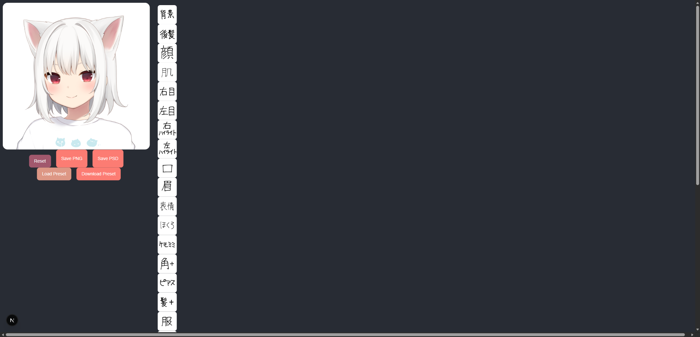

# amachiromaker-next

A Next.js port of amachiromaker — a browser-based character maker that composites layered images from Picrew-style assets.

The goal of this port is **exact visual and behavioural parity** with the original React app: same layout, sizing, fonts, borders, assets, presets, and export output.



## Features

- **Layered character composition** — 25 layers (background, hair, face, eyes, clothes, …) rendered with `merge-images`.
- **Items and colours** — pick an item per layer and switch between its colour variants.
- **Live preview** — the composed image updates as soon as a layer changes.
- **Persistent state** — the current combination is stored in `localStorage` and restored on reload.
- **Reset** — restores the default combination.
- **PNG export** — saves the composed image.
- **PSD export** — writes a 600×600 PSD with one named layer per visible layer (`ag-psd`).
- **Preset import/export** — download the current combination as JSON, or load a previously saved preset.

## Tech stack

- [Next.js](https://nextjs.org) 16 (App Router, Turbopack, React Compiler)
- React 19
- TypeScript
- [react-tabs](https://github.com/reactjs/react-tabs), [merge-images](https://github.com/lukechilds/merge-images), [ag-psd](https://github.com/Agamnentzar/ag-psd), [file-saver](https://github.com/eligrey/FileSaver.js)
- Tailwind CSS 4 (imported without Preflight so the original stylesheet is preserved)
- [Biome](https://biomejs.dev) for linting and formatting

## Getting started

```bash
npm install
npm run dev
```

Open [http://localhost:3000](http://localhost:3000).

### Scripts

| Script              | Description                    |
| ------------------- | ------------------------------ |
| `npm run dev`       | Start the development server   |
| `npm run build`     | Create a production build      |
| `npm start`         | Serve the production build     |
| `npm run lint`      | Run Biome checks               |
| `npm run format`    | Format files with Biome        |
| `npm run typecheck` | Type-check with `tsc --noEmit` |

## Deployment

The app is a single static page, so it can be exported:

```bash
STATIC_EXPORT=true npm run build
```

The static site is written to `out/`. To host it under a sub-path, set `NEXT_PUBLIC_BASE_PATH` at build time; asset URLs are prefixed through `src/lib/basePath.ts`.

## Project structure

```
app/
  layout.tsx               Root layout, metadata, global styles
  page.tsx                 Server component that loads the layer data
  globals.css              Upstream stylesheet (verbatim) + Tailwind (no Preflight)
src/
  components/
    AmachiromakerClient.tsx  Main interactive UI (client component)
  lib/
    basePath.ts            Asset path helper for basePath/static export
    data.ts                Typed accessors for the bundled layer data
    defaultCombination.json  Default layer/item/colour selection
    orderedLayers.json       Layer definitions, items, colours, thumbnails
  hooks.ts                 Window dimensions hook (responsive sizing)
  types.ts                 Layer and LayerImage types
  vendor.d.ts              Type declarations for merge-images and file-saver
public/
  app/image_maker/...      Layer, item and thumbnail PNGs
  emptyset.svg             "Remove item" placeholder
  favicon.png, manifest.json, robots.txt
```

## Parity notes

- Markup and class names mirror the upstream `App.tsx` / `App.css`.
- Tailwind is imported with only `theme` and `utilities` (no Preflight) because Preflight's global `box-sizing`, `img { max-width: 100% }`, and `button { font: inherit }` rules change the original layout.
- Layer/item/thumbnail images live under `public/app/...` and are resolved through `assetPath()`, so they work at the root or under a configured base path.
- Data is bundled from the upstream `public/defaultCombination.json` and `public/orderedLayers.json` (contents are identical).

## Credits

Original amachiromaker app and artwork belong to their original creators.
